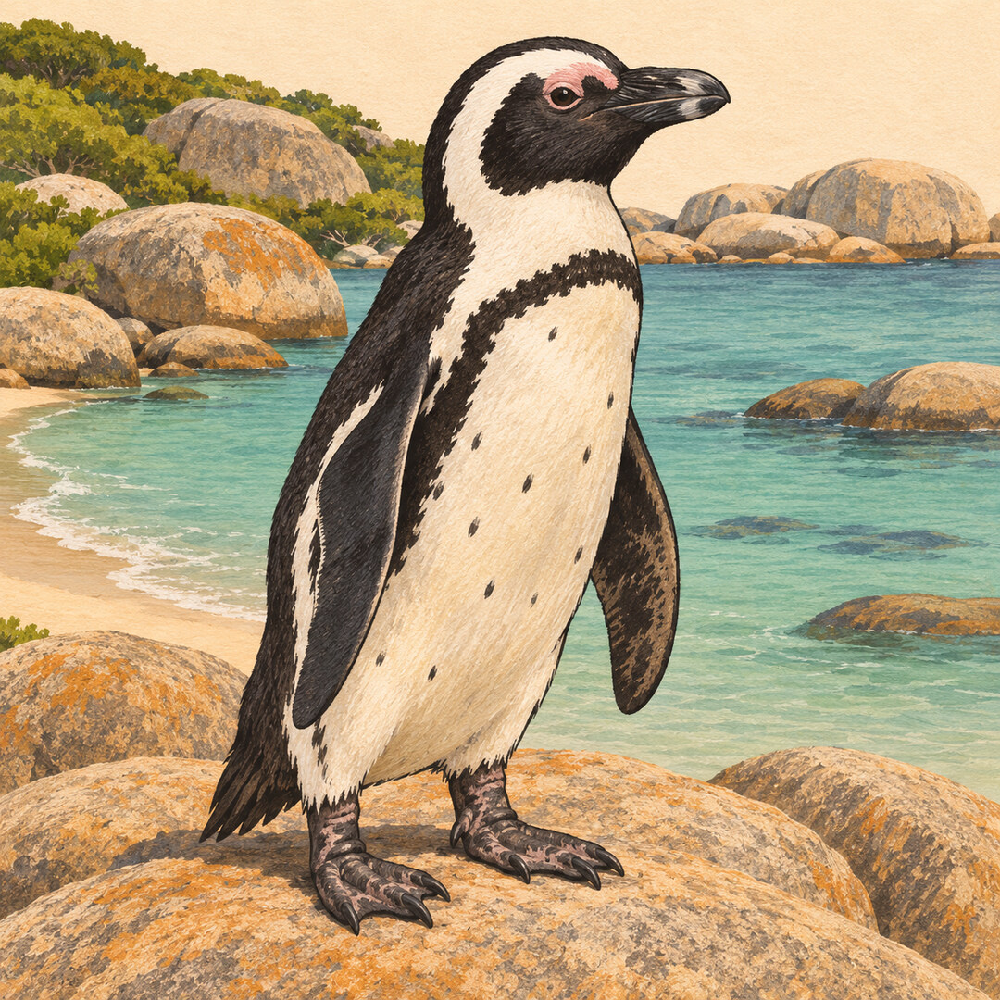
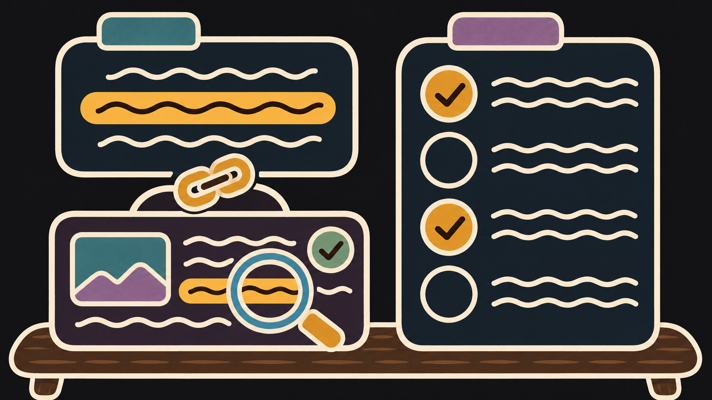

## What RAGTIME asks {#track-task}

```{=html}
<div class="task-figure">
  
  
  <div class="task-labels">
    <div><h3>Report request</h3><p>Problem, background, character limit</p></div>
    <div><h3>News in four languages</h3><p>English · Spanish · Russian · Chinese</p></div>
    <div><h3>English report</h3><p>Citations that support each factual sentence</p></div>
  </div>
</div>
<p class="foot"><a href="#/request">Next · African penguin conservation</a></p>
```

::: {.notes}
RAGTIME evaluates English report writing from multilingual news. Our submission covers the report-generation task. The track also evaluates multilingual retrieval and request decomposition as separate tasks. The organizer-supplied request includes the problem statement, requester background and a character limit. Each cited article must support the factual sentence that cites it. The tags at the ends of the report lines show where citations go.

In the evaluation, citation support checks sentence–source pairs. Nugget coverage asks how many of the organizers’ expected facts were covered. These are the two metrics we return to after the walkthrough. [Track overview](https://trec-ragtime.github.io/#tasks) · [Track guidelines](https://docs.google.com/document/d/1XqypNTHxIdazxfnUebrp-EsUuGNhodhQGrJIDnYGaB4/edit)
:::

## The request for an African penguin report {#request}

```{=html}
<div class="request-layout">
  <div>
    <p class="label">Topic 2014 · Report generation</p>
    <dl class="writer-input">
      <div><dt>Problem statement</dt><dd>Report on <mark>African penguin population changes</mark>, causes of decline, expert estimates of extinction risk and efforts to protect the species in South Africa and abroad.</dd></div>
      <div><dt>Requester background</dt><dd>A zoo grants manager needs evidence to decide the size and focus of a multi-year conservation grant.</dd></div>
      <div><dt>Output limit</dt><dd><strong>5,000 characters</strong> · English sentences with citations to the original articles</dd></div>
    </dl>
    <p class="foot"><a href="https://github.com/npatta01/trec_ragtime_2026/blob/a4561cf097dcfaf249ddfc3dcf25845a897d187a/topics/topics.all.2026.v0625-fix.jsonl#L15">Original request fields</a></p>
  </div>
  <figure class="request-species">
    
    <figcaption>Native to the coasts of South Africa and Namibia. <a href="https://www.aquarium.co.za/foundation/animals/african-penguin">Species profile</a></figcaption>
  </figure>
</div>
```

::: {.notes}
The slide paraphrases the organizers’ problem statement and requester background. The saved request also supplies the title, topic ID, collection ID and character limit. We follow this request through the searches, selected evidence, submitted report and organizer judgments. The drawing depicts an African penguin at Boulders Beach, near Cape Town. [Species profile](https://www.aquarium.co.za/foundation/animals/african-penguin)
:::

## Retrieval {#retrieval .divider .illustrated}

```{=html}
<div class="section-art">
  
  
</div>
<ol class="retrieval-route" aria-label="Retrieval steps">
  <li><a href="#/topic-queries">Plan queries</a></li>
  <li><a href="#/translation">Search and load English text</a></li>
</ol>
```

::: {.notes}
The order is the same throughout the run. Planning produces several English queries. The organizer service retrieves document IDs. Our pipeline looks up the English text for each ID. We then rerank each query’s list.
:::

## How DeepSeek split the penguin request {#topic-queries}

```{=html}
<div id="query-planning" class="planning-line">
  <div><strong>Problem statement</strong><br>+ requester background</div>
  <span class="planning-arrow" aria-hidden="true">→</span>
  <div class="planner model-lockup"><strong>DeepSeek V4 Flash</strong></div>
  <span class="planning-arrow" aria-hidden="true">→</span>
  <div class="query-count"><p class="label">Generated queries</p><strong>1</strong> broad + <strong>7</strong> focused</div>
</div>
<dl class="query-examples">
  <div class="broad-query"><dt><strong>q₀</strong> Broad rewrite</dt><dd><code>African penguin population decline causes conservation measures South Africa international protection extinction risk</code></dd></div>
  <div><dt><strong>q₄</strong> South African measures</dt><dd><code>South Africa African penguin conservation actions marine protected areas breeding sites</code></dd></div>
  <div><dt><strong>q₇</strong> Fishing restrictions</dt><dd><code>African penguin conservation measures government regulations fishing restrictions</code></dd></div>
</dl>
<p class="foot">Keep one list per query · <strong>851 lists</strong> across 103 requests · <a href="#/query-appendix">All eight penguin queries</a></p>
```

::: {.notes}
For Topic 2014, DeepSeek V4 Flash reads the problem statement and requester background. The saved model output has a single_query field for the broad rewrite q0 and a facet_queries array for q1 through q7. The three query strings are verbatim. The q4 search leads to the Chinese article used to show translation. The q7 search leads to the News24 article we follow through scoring. The model ID is deepseek/deepseek-v4-flash-20260423. The full handoff records 851 list entries across 103 topics. These include reuses of cached search results. [Notebook paper, Table 1](https://github.com/npatta01/trec_ragtime_2026/blob/a4561cf097dcfaf249ddfc3dcf25845a897d187a/paper/ragtime2026-np-draft.tex#L126)
:::

## English queries and supplied translations {#translation}

```{=html}
<div id="organizer-search" class="search-trace">
  <div class="search-input"><strong>English query</strong></div>
  <span class="planning-arrow" aria-hidden="true">→</span>
  <div class="organizer-index">
    <p class="label">Organizers’ search endpoint</p>
    <h3>ragtime2%100</h3>
    <ul class="search-languages" aria-label="Indexed news languages"><li>English</li><li>Spanish</li><li>Russian</li><li>Chinese</li></ul>
    <p>Qwen3-Embedding-8B · FAISS · RoutIR ScoreFusion<br>25 hits per language · about 4M original news articles</p>
  </div>
  <span class="planning-arrow" aria-hidden="true">→</span>
  <div class="search-output"><p class="label">Returned per query</p><strong>100 ranked document IDs</strong></div>
</div>
<div class="translation-stage">
  <span class="fragment step-marker" aria-hidden="true" data-fragment-index="0"></span>
  <div class="translation-bridge">
    <p class="id-stamp"><strong>One Chinese search hit</strong> <code title="17623319-2c6b-44ed-975b-bedd8a67fd24_483118047">…_483118047</code></p>
    <span class="planning-arrow" aria-hidden="true">→</span>
    <p><strong>Load English article text</strong><small>Original English or organizer-supplied <code>mt_docs</code> translation by ID</small></p>
    <span class="planning-arrow" aria-hidden="true">→</span>
    <p><a href="#/rerank">Reranking</a></p>
  </div>
  <p class="paper-label"><strong>China Times on bird flu at Boulders Beach, South Africa</strong><span class="language-swap"><span class="language-original"> · Original Chinese</span><span class="language-english"> · Supplied English machine translation</span></span></p>
  <div class="translation-text">
    <blockquote class="original-text" lang="zh-Hant">… <mark>28隻瀕臨絕種的企鵝</mark>有些因感染疾病死亡，有些則因染疫，難逃被撲殺命運。</blockquote>
    <blockquote class="english-text">… some of the <mark>28 endangered penguins</mark> have died from infection and others have been killed because of the disease.</blockquote>
  </div>
  <p class="foot translation-use"><a href="https://github.com/npatta01/trec_ragtime_2026/blob/a4561cf097dcfaf249ddfc3dcf25845a897d187a/submissions/np-nugget-sol-v1/NP.np-nugget-sol-v1.ragtime26.jsonl#L15">The submitted report</a> cites this Chinese original for the count of 28 penguins that died or were culled.</p>
</div>
```

::: {.notes}
The organizers hosted the four-language corpus index and search endpoint. Their documented ragtime2 alias is {zho%25, spa%25, rus%25, eng%25}ScoreFusion. The released default collection has 1,000,095 Common Crawl News articles per language, sampled August 2021 to July 2024. The mt_docs configuration supplies English representations with the same IDs for the three non-English languages. We run each query with ragtime2%100 and hydrate its ranked IDs locally. Each of the eight Topic 2014 searches returned 100 IDs, all with their English representation available. [Organizer search API](https://trec-ragtime.github.io/search_api.html) · [Notebook paper, retrieval](https://github.com/npatta01/trec_ragtime_2026/blob/a4561cf097dcfaf249ddfc3dcf25845a897d187a/paper/ragtime2026-np-draft.tex#L150)

Advance once to show the supplied English translation while the original China Times document ID stays visible. Across all eight queries, English text was available for every returned position. The dataset card credits HLTCOE with producing the translations using Sockeye. We join Spanish, Russian and Chinese translation rows by original ID. For English articles such as News24 we use the original text. The submitted report cites China Times and a second Chinese article for the sentence about the 28 penguins that died or were culled. [Submitted report](https://github.com/npatta01/trec_ragtime_2026/blob/a4561cf097dcfaf249ddfc3dcf25845a897d187a/submissions/np-nugget-sol-v1/NP.np-nugget-sol-v1.ragtime26.jsonl#L15) · [Dataset card](https://huggingface.co/datasets/trec-ragtime/ragtime2/blob/main/README.md)
:::

## Reranking {#rerank .divider}

```{=html}
<div class="rerank-flow">
  <div><p class="label">100 candidates per query</p><strong>Query + English article text</strong></div>
  <span class="planning-arrow" aria-hidden="true">→</span>
  <div class="planner model-lockup"><div><p class="label">Mixedbread cross-encoder</p><strong>mxbai-rerank-base-v2</strong><p class="model-purpose">Scores the pair for relevance</p></div></div>
  <span class="planning-arrow" aria-hidden="true">→</span>
  <div><p class="label">For each query</p><strong>Sort the articles by score</strong></div>
</div>
<p class="rerank-count">Topic 2014 · <strong>8 × 100 = 800</strong> query–article pairs · <strong>601</strong> distinct articles</p>
<p class="foot"><a href="#/reranking">Compare search and reranked positions</a></p>
```

::: {.notes}
We score each query with the English text of each candidate and sort each list by its relevance scores. The eight saved score maps each cover the English text hashes of all 100 returned articles. The same article can get different scores for different queries. The scored retrieval ranks reproduce the positions in the Topic 2014 handoff. The run uses document-scale evidence. The exact scorer input limits are unrecovered. Claim support is assessed in report generation. [Notebook paper, Figure 2](https://github.com/npatta01/trec_ragtime_2026/blob/a4561cf097dcfaf249ddfc3dcf25845a897d187a/paper/ragtime2026-np-draft.tex#L150)
:::

## Reranking the penguin articles {#reranking}

```{=html}
<p class="label">Topic 2014 · Two articles cited in the final report</p>
<table class="rerank-comparison" aria-label="Before and after ranks of two cited articles">
  <thead><tr><th scope="col">Article</th><th scope="col">Query</th><th scope="col">Search rank</th><th scope="col">Mixedbread rank</th><th scope="col">Kept in</th></tr></thead>
  <tbody>
    <tr><th scope="row">News24 on fishing restrictions<span class="article-language">Originally in English</span></th><td>q₇ · Fishing restrictions</td><td>16</td><td><strong>1</strong></td><td>Round 1</td></tr>
    <tr class="translated-rank"><th scope="row"><a href="#translation/0">China Times on South Africa’s bird-flu response</a><span class="article-language">Patrols and quarantine at Boulders Beach<br>Supplied English translation</span></th><td>q₄ · South African measures</td><td>60</td><td><strong>2</strong></td><td>Round 2</td></tr>
  </tbody>
</table>
<p class="foot">Each rank is within that query’s 100 candidates. <a href="#/nugget-extraction">See which articles we kept</a></p>
```

::: {.notes}
News24 moves from 16th to first for q7 and directly addresses fishing restrictions around breeding colonies. China Times moves from 60th to second for q4. The Chinese-language article covers a bird-flu outbreak at Boulders Beach near Cape Town. It describes daily patrols for sick penguins and plans to quarantine birds with symptoms. The cached Mixedbread score maps reproduce both positions. The run selected both articles and cited them in the final report. [Paper, reranking](https://github.com/npatta01/trec_ragtime_2026/blob/a4561cf097dcfaf249ddfc3dcf25845a897d187a/paper/ragtime2026-np-draft.tex#L150) · [Submitted report](https://github.com/npatta01/trec_ragtime_2026/blob/a4561cf097dcfaf249ddfc3dcf25845a897d187a/submissions/np-nugget-sol-v1/NP.np-nugget-sol-v1.ragtime26.jsonl#L15)
:::

## Select 24 articles across the reranked lists {#nugget-extraction}

```{=html}
<div class="selection-flow">
  <div>
    <p class="label">Round-robin across 8 reranked lists</p>
    <table class="selection-table" aria-label="Selected articles by reranked position and query for topic 2014">
      <thead><tr><th scope="col">Rank</th><th scope="col">q₀</th><th scope="col">q₁</th><th scope="col">q₂</th><th scope="col">q₃</th><th scope="col">q₄</th><th scope="col">q₅</th><th scope="col">q₆</th><th scope="col">q₇</th><th scope="col">New</th></tr></thead>
      <tbody>
      <tr><th scope="row">1</th><td class="selected"><span class="article-mark" aria-hidden="true"></span><span class="chart-sr">Selected</span></td><td class="unselected duplicate"><span aria-hidden="true">×</span><span class="chart-sr">Duplicate article</span></td><td class="unselected duplicate"><span aria-hidden="true">×</span><span class="chart-sr">Duplicate article</span></td><td class="selected"><span class="article-mark" aria-hidden="true"></span><span class="chart-sr">Selected</span></td><td class="unselected duplicate"><span aria-hidden="true">×</span><span class="chart-sr">Duplicate article</span></td><td class="selected"><span class="article-mark" aria-hidden="true"></span><span class="chart-sr">Selected</span></td><td class="unselected duplicate"><span aria-hidden="true">×</span><span class="chart-sr">Duplicate article</span></td><td class="selected featured" title="News24 on fishing restrictions"><span class="article-mark" aria-hidden="true"></span><span class="chart-sr">News24 on fishing restrictions selected</span></td><td class="row-count">4</td></tr>
      <tr><th scope="row">2</th><td class="unselected duplicate"><span aria-hidden="true">×</span><span class="chart-sr">Duplicate article</span></td><td class="unselected duplicate"><span aria-hidden="true">×</span><span class="chart-sr">Duplicate article</span></td><td class="unselected duplicate"><span aria-hidden="true">×</span><span class="chart-sr">Duplicate article</span></td><td class="unselected duplicate"><span aria-hidden="true">×</span><span class="chart-sr">Duplicate article</span></td><td class="selected featured" title="China Times on bird flu"><span class="article-mark" aria-hidden="true"></span><span class="chart-sr">China Times on bird flu selected</span></td><td class="unselected duplicate"><span aria-hidden="true">×</span><span class="chart-sr">Duplicate article</span></td><td class="unselected duplicate"><span aria-hidden="true">×</span><span class="chart-sr">Duplicate article</span></td><td class="selected"><span class="article-mark" aria-hidden="true"></span><span class="chart-sr">Selected</span></td><td class="row-count">2</td></tr>
      <tr><th scope="row">3</th><td class="unselected duplicate"><span aria-hidden="true">×</span><span class="chart-sr">Duplicate article</span></td><td class="selected"><span class="article-mark" aria-hidden="true"></span><span class="chart-sr">Selected</span></td><td class="selected"><span class="article-mark" aria-hidden="true"></span><span class="chart-sr">Selected</span></td><td class="unselected duplicate"><span aria-hidden="true">×</span><span class="chart-sr">Duplicate article</span></td><td class="selected"><span class="article-mark" aria-hidden="true"></span><span class="chart-sr">Selected</span></td><td class="unselected duplicate"><span aria-hidden="true">×</span><span class="chart-sr">Duplicate article</span></td><td class="unselected duplicate"><span aria-hidden="true">×</span><span class="chart-sr">Duplicate article</span></td><td class="selected"><span class="article-mark" aria-hidden="true"></span><span class="chart-sr">Selected</span></td><td class="row-count">4</td></tr>
      <tr class="later-rounds"><th scope="row">4–9</th><td colspan="8">3 + 3 + 3 + 2 + 2 + 1</td><td class="row-count">14</td></tr>
      </tbody>
    </table>
    <p class="selection-key">× Duplicate · <span class="article-mark featured" aria-hidden="true"></span> Two cited examples</p>
  </div>
  <div class="selection-summary">
    <p class="selection-total"><strong>24</strong> unique articles</p>
    <p>Take one result per list each round. Skip duplicates and stop at 24.</p>
    <p class="selection-key">Original languages · 14 English, 2 Spanish, 2 Russian, 6 Chinese</p>
    <p class="selection-key">News24 at q₇ rank 1 · China Times at q₄ rank 2</p>
  </div>
</div>
<p class="foot">The selected articles go to <a href="#/nugget-example">Nuggetizer</a>.</p>
```

::: {.notes}
Read across each row from q0 to q7. We deduplicate by document ID and span. The eight saved score maps reproduce the full round-robin sequence of 24 unique articles. The table shows the first three rounds by query, then the counts for rounds four through nine. After ten articles in the first three rounds, we keep fourteen more and reach the cap at q1 rank 9. The two highlights connect the selected pool to the previous slide. [Evidence selection](https://github.com/npatta01/trec_ragtime_2026/blob/a4561cf097dcfaf249ddfc3dcf25845a897d187a/paper/ragtime2026-np-draft.tex#L150)
:::

## Report generation {#generation .divider .illustrated}

```{=html}
<div class="section-art">
  
  
</div>
<ol class="retrieval-route" aria-label="Report generation steps">
  <li><a href="#/nugget-example">Extract nuggets</a></li>
  <li><a href="#/report-writer">Write and cite</a></li>
</ol>
```

::: {.notes}
The 24 selected articles supply the evidence for the African penguin report on Topic 2014. Follow the News24 article from an extracted nugget to the cited sentence. [Notebook paper](https://github.com/npatta01/trec_ragtime_2026/blob/a4561cf097dcfaf249ddfc3dcf25845a897d187a/paper/ragtime2026-np-draft.tex#L150)
:::

## Extract nuggets {#nugget-example .generation-phase}

```{=html}
<div class="extraction-flow">
  <p><strong>24</strong> selected articles</p>
  <span class="planning-arrow" aria-hidden="true">→</span>
  <p><strong>Nuggetizer</strong><small>Extract claims across the set.<br>Check each claim against all 24 articles.</small></p>
  <span class="planning-arrow" aria-hidden="true">→</span>
  <p><strong>19</strong> nuggets kept<small>Each had full support</small></p>
</div>
<p class="metric-detail extraction-sources"><strong>11</strong> distinct articles fully supported at least one retained nugget. The report cited <strong>7</strong> of those articles.</p>
<div class="nugget-samples">
  <p class="label">Two nuggets from the African penguin run</p>
  <ul>
    <li>Fishing ban aims to increase prey availability for penguins</li>
    <li>Penguin breeding pairs declined 77% in 30 years</li>
  </ul>
</div>
```

::: {.notes}
Nuggetizer uses all 24 selected articles to create one set of candidate claims. It checks each candidate against each article. We merge similar claims using MiniLM cosine ≥ 0.92 with number and negation checks, then cap the topic at 20 by importance and best supporting-source score. Topic 2014 retained 19 nuggets with no recorded rejections. Each had at least one full-support link. The set stayed below the 20-nugget cap. Seventeen distinct articles had a full or partial support link, and 11 had full support for at least one retained nugget. Seven of those 11 articles were cited in the submitted report. The first example is supported by News24 and Hakai Magazine. The second is supported by the Daily Maverick article. [Nuggetizer package](https://github.com/castorini/nuggetizer) · [Notebook paper](https://github.com/npatta01/trec_ragtime_2026/blob/a4561cf097dcfaf249ddfc3dcf25845a897d187a/paper/ragtime2026-np-draft.tex#L180)
:::

## Nuggets guide the report {#report-writer .generation-phase}

```{=html}
<p class="label">Topic 2014 · GPT-5.6 Sol</p>
<ol class="coverage-trace" aria-label="How nuggets guide the report">
  <li><strong>Plan coverage</strong><p>Use the request and 19 extracted nuggets.</p></li>
  <li><strong>Allocate space</strong><p>Use 4,900 characters. More fully supporting articles give a nugget more space.</p></li>
  <li class="trace-gap"><strong>Write with citations</strong><p>Use eligible articles for details. Map source labels to original article IDs.</p></li>
</ol>
<div class="nugget-reveal writing-example">
  <p class="label">2 supporting articles · 239 characters for this nugget</p>
  <p class="decision-claim">Fishing ban aims to increase prey availability for penguins</p>
</div>
<p class="foot">The nugget puts fishing restrictions on the writing plan. News24 supplies the <a href="#/cited-sentence">2008 study result</a>.</p>
```

::: {.notes}
The submitted file contains report sentences and citations to original article IDs. Nuggets guide coverage and character allocation. Their full-support links define the eligible evidence for writing and citation. The writer gets the original request, the supported nuggets with allocations, and eligible evidence. We reserve one character for each supported nugget, then distribute the rest by the number of articles that fully support it. There are 41 full-support links across the 19 retained nuggets. A nugget with one supporting article was allocated 120 characters. The fishing-restrictions nugget, F8, has two supporting articles and gets 239 characters. This nugget puts fishing restrictions on the writing plan. The writer’s sentence tagged F8 draws the 2008 study result from News24, cited via e004. [Paper, writing](https://github.com/npatta01/trec_ragtime_2026/blob/a4561cf097dcfaf249ddfc3dcf25845a897d187a/paper/ragtime2026-np-draft.tex#L211)
:::

## Check the report before submitting {#writer-checks .generation-phase}

```{=html}
<ol class="coverage-trace" aria-label="Writer output checks">
  <li><strong>Validate citation labels</strong><p>Require an eligible source label for each factual sentence.</p></li>
  <li><strong>Allow one rewrite</strong><p>Send validation errors back to the writer.</p></li>
  <li><strong>Fit 5,000 characters</strong><p>Keep whole sentences and resolve citations to original IDs.</p></li>
</ol>
```

::: {.notes}
The model returns one JSON record per proposed sentence. It contains the sentence text, source handles, IDs of claims it covers, and a factual-sentence flag. We check sentence structure, repeated text, valid citation handles, and required citations for factual sentences. These checks validate sentence structure and citation eligibility within the topic. The organizers assess whether each cited article supports its sentence after submission. Failed validation can trigger one rewrite. The length check uses NFKC-normalized text and reserves a separator between sentences. [Notebook paper](https://github.com/npatta01/trec_ragtime_2026/blob/a4561cf097dcfaf249ddfc3dcf25845a897d187a/paper/ragtime2026-np-draft.tex#L211)
:::

## How AutoARGUE scored a cited sentence {#cited-sentence .generation-phase}

```{=html}
<figure class="citation-source">
  <figcaption>News24 article · English original</figcaption>
  <blockquote>“Research carried out in <mark>2008</mark> found that restricted fishing around four breeding colonies slowed down … population decline from around <strong>7% to 5% per year</strong>.”</blockquote>
</figure>
<figure class="submitted">
  <figcaption>Submitted English report</figcaption>
  <blockquote>A <mark>2008</mark> experiment found that restricted fishing around four colonies slowed annual population decline from about <strong>7% to 5%</strong>.<sup><a href="https://github.com/npatta01/trec_ragtime_2026/blob/a4561cf097dcfaf249ddfc3dcf25845a897d187a/submissions/np-nugget-sol-v1/NP.np-nugget-sol-v1.ragtime26.jsonl#L15" aria-label="View the News24 citation in the submitted report">1</a></sup></blockquote>
</figure>
<p class="foot">[1] News24 · <code title="bc77e817-36eb-4504-8076-3fc4a1aa1c42_415417328">…_415417328</code> · <a href="https://github.com/npatta01/trec_ragtime_2026/blob/a4561cf097dcfaf249ddfc3dcf25845a897d187a/submissions/np-nugget-sol-v1/NP.np-nugget-sol-v1.ragtime26.jsonl#L15">Submitted report</a> · <a href="#/score-example">Penguin results</a></p>
<dl class="citation-footer">
  <div>
    <dt>Citation support</dt>
    <dd>News24 supports the whole sentence.</dd>
  </div>
  <div>
    <dt>Nugget coverage</dt>
    <dd><strong>2008</strong> answers “When was the study conducted?”</dd>
  </div>
</dl>
```

::: {.notes}
The excerpt is from the saved News24 article, with an ellipsis marking omitted words. The writer output links this sentence to F8 and cites e004. The submitted report resolves e004 to the original document ID bc77e817-36eb-4504-8076-3fc4a1aa1c42_415417328. The full report has 34 sentences and 7 distinct cited articles. It uses 3,437 budgeted characters, including the separators between sentences. AutoARGUE judged the article to support this sentence. Both organizer evaluations credited the reference answer of 2008 to the question about when the restricted-fishing research was conducted. [Submitted Topic 2014 report](https://github.com/npatta01/trec_ragtime_2026/blob/a4561cf097dcfaf249ddfc3dcf25845a897d187a/submissions/np-nugget-sol-v1/NP.np-nugget-sol-v1.ragtime26.jsonl#L15)
:::

## Penguin topic results {#score-example}

```{=html}
<div class="topic-results" role="group" aria-label="Topic 2014 retrieval and report results">
  <div>
    <p class="label">Topic 2014 · Organizer reference articles</p>
    <div class="example-scores reference-scores">
      <p><strong>13/13</strong> retrieved</p>
      <p><strong>10/13</strong> selected</p>
      <p><strong>7/13</strong> cited</p>
    </div>
  </div>
  <div>
    <p class="label">Submitted report · Preliminary AutoARGUE</p>
    <div class="example-scores">
      <p class="covered-score"><strong>10/16</strong> nuggets covered</p>
      <p class="supported-score"><strong>36/36</strong> citations supported</p>
    </div>
  </div>
</div>
<div class="credited-nuggets" role="group" aria-labelledby="credited-nuggets-heading">
  <h3 id="credited-nuggets-heading">Examples AutoARGUE credited</h3>
  <ul>
    <li>Breeding pairs fell by <strong>77% over 30 years</strong>.</li>
    <li>Conservation leaders named <strong>food scarcity</strong> as the main threat.</li>
    <li>South Africa extended fishing restrictions for <strong>at least 10 years</strong>.</li>
  </ul>
</div>
<p class="topic-next"><a href="#/coverage-gaps">Six details the report missed <span aria-hidden="true">→</span></a></p>
<p class="foot"><a href="#/reference-articles">All 13 article matches</a> · <a href="https://github.com/npatta01/trec_ragtime_2026/blob/061c1b4de0ac6a982710ebeb2d5df350c4645c1b/results/2026-11-02/sources/nuggets_1101.tgz">Organizer nugget bank</a> · <a href="https://github.com/npatta01/trec_ragtime_2026/blob/061c1b4de0ac6a982710ebeb2d5df350c4645c1b/results/2026-11-02/scores/repgen.autoargue.34-topics/np-nugget-sol-v1.scores.tsv#L122-L133">Topic scores</a></p>
```

::: {.notes}
We submitted one report for Topic 2014. Preliminary AutoARGUE gave it credit for 10 of 16 organizer reference nuggets and judged all 36 citations supported.

We matched the full IDs in the topic’s organizer nugget bank against the eight saved search lists. All 13 distinct reference articles appeared in the 601 unique hits. Ten made the 24-article selection, and the report cited seven. The seven cited articles are distinct sources. The 36 citations are sentence-level links to those sources.

Additional credited examples include the native range in South Africa and Namibia, the 2008 study year, the conditional 2035 extinction projection and New England Aquarium’s Species Survival Plan work. [Topic 2014 scores](https://github.com/npatta01/trec_ragtime_2026/blob/a4561cf097dcfaf249ddfc3dcf25845a897d187a/results/2026-11-02/scores/repgen.autoargue.34-topics/np-nugget-sol-v1.scores.tsv#L122) · [Organizer judgments and nugget bank](https://github.com/npatta01/trec_ragtime_2026/blob/a4561cf097dcfaf249ddfc3dcf25845a897d187a/results/2026-11-02/README.md#files-and-provenance)
:::

## Six details the penguin report missed {#coverage-gaps}

```{=html}
<p class="coverage-summary"><strong>Selected articles contained all six details.</strong> Five were in articles cited for other facts. All six were absent from the candidates Nuggetizer returned.</p>
<table class="coverage-comparison" aria-label="Six uncredited details compared against the submitted penguin report and selected sources">
  <thead><tr><th scope="col">Missing reference detail</th><th scope="col">Related text in our report</th><th scope="col">Selected article with the detail</th></tr></thead>
  <tbody>
    <tr>
      <th scope="row">9,900 breeding pairs worldwide</th>
      <td><q>about 20,000 today</q> (individual birds)</td>
      <td>Daily Maverick <span class="source-status">· cited</span></td>
    </tr>
    <tr>
      <th scope="row">13,200 breeding pairs in 2019</th>
      <td>Breeding pairs <q>declined by 77% over 30 years</q></td>
      <td>News24 <span class="source-status">· cited</span></td>
    </tr>
    <tr>
      <th scope="row">97% decline over a century</th>
      <td>From <q>as many as two million</q> a century ago to <q>about 20,000 today</q></td>
      <td>NBC Boston <span class="source-status">· cited</span></td>
    </tr>
    <tr>
      <th scope="row">Bee swarm killed 63 penguins</th>
      <td>28 killed or culled in a separate bird-flu outbreak</td>
      <td>Gazeta.ua and RFI<br><span class="source-status">Outside writer’s sources</span></td>
    </tr>
    <tr>
      <th scope="row">Names of the targeted colonies<br><span class="reference-detail">Dassen Island, Robben Island, Stony Point, Dyer, Bird Island, St Croix</span></th>
      <td><q>six of the seven largest</q> colonies, without the names</td>
      <td>News24 <span class="source-status">· cited</span></td>
    </tr>
    <tr>
      <th scope="row">Fishing in less sensitive areas</th>
      <td><strong>3 of 4 measures matched.</strong> Fishing limits, government action and fish availability.</td>
      <td>News24 <span class="source-status">· cited</span></td>
    </tr>
  </tbody>
</table>
<p class="foot"><a href="#/score-example">Penguin topic results</a> · <a href="https://github.com/npatta01/trec_ragtime_2026/blob/061c1b4de0ac6a982710ebeb2d5df350c4645c1b/submissions/np-nugget-sol-v1/NP.np-nugget-sol-v1.ragtime26.jsonl#L15">Submitted report</a> · <a href="#/cited-sentence">Cited sentence</a></p>
```

::: {.notes}
Five questions had no matched answer. The conservation-measures question required all four answers and matched three. The missing fourth answer was fishing in less sensitive areas. Applying the organizer bank’s AND and OR rules to the saved sentence judgments reproduces 10/16.

Every missed detail appears in the selected English evidence for at least one organizer-listed article. The saved bundle has 19 distinct claim variants. All six details were absent from those variants. Our downstream filters recorded zero rejections for atomicity, support or the 20-nugget limit. Clustering preserves every distinct normalized variant, so the six details were already absent from the candidates Nuggetizer returned. The run saved no intermediate lists from Nuggetizer’s creator windows or raw importance labels. We can locate the gaps at Nuggetizer’s output. The exact step within the package is unknown.

All 19 retained nuggets qualified for the writing plan. The saved writer draft has the same 34 sentences as the submitted report, with zero repairs or rejections. The six reference details are coverage gaps. AutoARGUE supported every citation. [Post-extraction checks](https://github.com/npatta01/trec_ragtime_2026/blob/95faef084ef7409eb5ac576c0689f48a476852cb/src/trec_ragtime/nuggets.py#L392)

- **9,900 breeding pairs worldwide.** Daily Maverick, selected and cited for other facts.
- **13,200 breeding pairs in 2019.** News24, selected and cited for other facts.
- **97% decline over a century.** NBC Boston, selected and cited for other facts.
- **Bee swarm killed 63 penguins.** All six listed articles were retrieved. Three were selected, two from Gazeta.ua and one from RFI. Their English translations contain the fact. These three articles stayed outside the writer’s eligible source list.
- **Targeted colonies.** News24 gave Dassen Island, Robben Island, Stony Point, Dyer, Bird Island and St Croix. The report gave the number of colonies. The reference bank accepted any one of the six names.
- **Fishing in less sensitive areas.** News24 contained the missing answer. AutoARGUE matched the other three measures, commercial fishing restrictions, government-led interventions and improving fish availability.

Five missing details were in sources that were eligible for writing and cited elsewhere in the report.
:::

## Scores across topics {#cost .divider .illustrated .closing-slide}

```{=html}
<div class="section-art">
  
  
</div>
<ol class="retrieval-route" aria-label="Aggregate results">
  <li><a href="#/overall">Citation support</a></li>
  <li><a href="#/nugget-coverage">Nugget coverage</a></li>
</ol>
```

::: {.notes}
The penguin example used AutoARGUE. The next two slides compare our aggregate citation support and nugget coverage with the other runs in each preliminary evaluation.
:::

## Citation support matched the highest score {#overall .field-results}

```{=html}
<p class="score-definition">Per citation · Did the article support the whole sentence? · 29 runs per evaluation</p>
<p class="metric-detail evaluation-scope"><strong>One submission</strong> · AutoARGUE (automated, 34 topics) · Mostly human (17-topic subset)</p>
<figure class="field-comparison" aria-label="Citation support across 29 runs">
  <figcaption class="field-legend"><span class="legend-np">NP Labs</span><span class="legend-median">Field median</span><span class="legend-max">Field max</span></figcaption>
  <div class="field-row">
    <h3>Mostly human <small>17 topics · llmfilled</small></h3>
    <div class="field-bars">
      <div class="field-pair" aria-hidden="true">
        <div class="field-track"><i class="bar-np" style="width:93.72%"></i></div>
        <div class="field-track"><i class="bar-median" style="width:81.55%"></i></div>
        <i class="field-marker" style="left:93.72%"></i>
      </div>
      <div class="field-values">
        <strong><span class="chart-sr">NP Labs </span>93.72%</strong>
        <span><span class="chart-sr">Field median </span>81.55%</span>
      </div>
    </div>
    <p class="field-max"><span>Max</span> <strong>93.72%</strong></p>
  </div>
  <div class="field-row">
    <h3>AutoARGUE <small>34 topics · micro</small></h3>
    <div class="field-bars">
      <div class="field-pair" aria-hidden="true">
        <div class="field-track"><i class="bar-np" style="width:95.73%"></i></div>
        <div class="field-track"><i class="bar-median" style="width:75.32%"></i></div>
        <i class="field-marker" style="left:95.73%"></i>
      </div>
      <div class="field-values">
        <strong><span class="chart-sr">NP Labs </span>95.73%</strong>
        <span><span class="chart-sr">Field median </span>75.32%</span>
      </div>
    </div>
    <p class="field-max"><span>Max</span> <strong>95.73%</strong></p>
  </div>
  <div class="field-axis" aria-hidden="true"><div class="field-bars"><div><span>0%</span><span>100%</span></div></div></div>
</figure>
<p class="metric-detail">Sentence support (all citations support their sentence) · <strong>93.44%</strong> mostly human · <strong>95.81%</strong> AutoARGUE</p>
<p class="foot">Mostly human · 687/700 citations human-judged. AutoARGUE · 1,324/1,383 citations supported.</p>
```

::: {.notes}
Both NP Labs bars end at the maximum reported by the organizers. The medians are for the same metric and evaluation as each bar. An equal maximum can include ties. The archive supplies field summaries and our individual scores. Almost-human uses citation_support_llmfilled. Human judgments account for 687 of its 700 citations. AutoARGUE uses citation_support_micro, aggregated across citations. [Mostly-human results](https://github.com/npatta01/trec_ragtime_2026/blob/a4561cf097dcfaf249ddfc3dcf25845a897d187a/results/2026-11-02/README.md#almost-human-17-topics) · [AutoARGUE results](https://github.com/npatta01/trec_ragtime_2026/blob/a4561cf097dcfaf249ddfc3dcf25845a897d187a/results/2026-11-02/README.md#autoargue-34-topics)
:::

## Nugget coverage beat the median {#nugget-coverage .field-results}

```{=html}
<p class="score-definition">How many organizer reference nuggets appeared in supported sentences?</p>
<p class="metric-detail evaluation-scope"><strong>One submission</strong> · AutoARGUE (automated, 34 topics) · Mostly human (17-topic subset)</p>
<figure class="field-comparison" aria-label="Nugget coverage across 29 runs">
  <figcaption class="field-legend"><span class="legend-np">NP Labs</span><span class="legend-median">Field median</span><span class="legend-max">Field max</span></figcaption>
  <div class="field-row">
    <h3>Mostly human <small>17 topics · llmfilled</small></h3>
    <div class="field-bars">
      <div class="field-pair" aria-hidden="true">
        <div class="field-track"><i class="bar-np" style="width:43.43%"></i></div>
        <div class="field-track"><i class="bar-median" style="width:35.81%"></i></div>
        <i class="field-marker" style="left:47.63%"></i>
      </div>
      <div class="field-values">
        <strong><span class="chart-sr">NP Labs </span>43.43%</strong>
        <span><span class="chart-sr">Field median </span>35.81%</span>
      </div>
    </div>
    <p class="field-max"><span>Max</span> <strong>47.63%</strong></p>
  </div>
  <div class="field-row">
    <h3>AutoARGUE <small>34 topics · micro</small></h3>
    <div class="field-bars">
      <div class="field-pair" aria-hidden="true">
        <div class="field-track"><i class="bar-np" style="width:39.16%"></i></div>
        <div class="field-track"><i class="bar-median" style="width:35.34%"></i></div>
        <i class="field-marker" style="left:49.40%"></i>
      </div>
      <div class="field-values">
        <strong><span class="chart-sr">NP Labs </span>39.16%</strong>
        <span><span class="chart-sr">Field median </span>35.34%</span>
      </div>
    </div>
    <p class="field-max"><span>Max</span> <strong>49.40%</strong></p>
  </div>
  <div class="field-axis" aria-hidden="true"><div class="field-bars"><div><span>0%</span><span>100%</span></div></div></div>
</figure>
<p class="foot">AutoARGUE · <strong>195 of 498</strong> reference nuggets covered · <a href="#/score-appendix">Scores, including F1</a></p>
```

::: {.notes}
The gap to the max is about 4 percentage points in the mostly-human evaluation and about 10 in AutoARGUE. These are two evaluations of one run, with different topic counts and judgment methods. Each comparison is within its own evaluation. The reference nuggets here come from the organizers’ assessment. Our extracted nuggets are an input to writing. Almost-human uses nugget_coverage_llmfilled. AutoARGUE uses nugget_coverage_micro, which credits 195 of 498 reference nuggets across 34 topics. These scores do not isolate the effect of any one pipeline step. [Organizer run scores and field summaries](https://github.com/npatta01/trec_ragtime_2026/blob/a4561cf097dcfaf249ddfc3dcf25845a897d187a/results/2026-11-02/README.md)
:::

## Conclusion {#conclusion .closing-slide}

```{=html}
<ul class="conclusion-method">
  <li>Sent English queries to the organizers’ endpoint</li>
  <li>Reranked English originals and organizer-supplied translations</li>
  <li>Used nuggets to guide cited reports</li>
</ul>
<p class="conclusion-result"><strong>One submission.</strong> Citation support matched the reported maximum and nugget coverage exceeded the median in both preliminary evaluations.</p>
```

::: {.notes}
DeepSeek generated English queries. The organizers provided the search endpoint and English machine translations. We used original English text or the supplied translations for Mixedbread reranking, and Nuggetizer claims guided GPT-5.6 Sol’s cited reports. The organizers scored one submission. AutoARGUE reports micro scores of 95.73% citation support and 39.16% nugget coverage on 34 topics. The mostly human evaluation reports llmfilled scores of 93.72% citation support and 43.43% nugget coverage on a 17-topic subset. Each citation-support score matches its evaluation’s reported maximum, and each coverage score exceeds its evaluation’s field median. [Organizer results](https://github.com/npatta01/trec_ragtime_2026/blob/a4561cf097dcfaf249ddfc3dcf25845a897d187a/results/2026-11-02/README.md)
:::

## Appendix {#appendix .divider}

::: {.lede}
Queries, <a href="#/reference-articles">article matches</a>, settings, scores and <a href="#/budget">writing cost</a>.
:::

## All eight queries for Topic 2014 {#query-appendix .retrieval}

::: {.compact-table}
| Query | Search text |
|---|---|
| q₀ (broad rewrite) | African penguin population decline causes conservation measures South Africa international protection extinction risk |
| q₁ | African penguin population trends historical counts breeding pairs over years |
| q₂ | major threats to African penguin decline fishing oil spills climate change habitat loss |
| q₃ | African penguin extinction risk assessment IUCN status expert opinion |
| q₄ | South Africa African penguin conservation actions marine protected areas breeding sites |
| q₅ | international efforts to protect African penguin conservation programs organizations |
| q₆ | African penguin population numbers current estimates latest census data |
| q₇ | African penguin conservation measures government regulations fishing restrictions |
:::

[Notebook paper, Table 1](https://github.com/npatta01/trec_ragtime_2026/blob/a4561cf097dcfaf249ddfc3dcf25845a897d187a/paper/ragtime2026-np-draft.tex#L126)

## Organizer reference article matches {#reference-articles}

<p class="label">Topic 2014 · 601 unique search hits · 24 articles selected for extraction</p>

| Organizer article | Document ID suffix | Best search hit | Selected | Cited |
|---|---|---|---|---|
| CBS News | `…_493999155` | q₀ · rank 4 | Yes | Yes |
| China Times | `…_483118047` | q₆ · rank 7 | Yes | Yes |
| Daily Maverick | `…_29057201` | q₀ · rank 1 | Yes | Yes |
| Gazeta.ua | `…_325848136` | q₆ · rank 17 | Yes | — |
| Gazeta.ua | `…_339284574` | q₆ · rank 18 | Yes | — |
| Hakai Magazine | `…_672465743` | q₂ · rank 2 | Yes | Yes |
| NBC Boston | `…_320019812` | q₆ · rank 4 | Yes | Yes |
| News24 | `…_415417328` | q₃ · rank 2 | Yes | Yes |
| RFI | `…_559172499` | q₆ · rank 6 | Yes | Yes |
| RFI | `…_854953281` | q₂ · rank 14 | Yes | — |
| China Times | `…_488800659` | q₆ · rank 26 | — | — |
| Echo of Moscow | `…_336318773` | q₆ · rank 73 | — | — |
| Minuto30 | `…_985288343` | q₆ · rank 22 | — | — |

<p class="foot">Matches use full document IDs. Best rank is across the eight search lists. <a href="https://github.com/npatta01/trec_ragtime_2026/blob/061c1b4de0ac6a982710ebeb2d5df350c4645c1b/results/2026-11-02/sources/nuggets_1101.tgz">Organizer nugget bank</a> · <a href="#/score-example">Penguin topic results</a></p>

::: {.notes}
This is the union of the document IDs attached to all 16 reference nuggets for Topic 2014 in the organizer’s `nuggets_1101/2014.json`. Join those IDs to the 601 distinct search hits. Each row shows the query with the best original search rank, before Mixedbread reranking. Ties use the lowest query index. Selection comes from the sealed 24-article evidence pool. Citation comes from the submitted `responses[].citations`. All seven distinct cited articles are organizer-listed. [Reference archive](https://github.com/npatta01/trec_ragtime_2026/blob/061c1b4de0ac6a982710ebeb2d5df350c4645c1b/results/2026-11-02/sources/nuggets_1101.tgz) · [Submitted report](https://github.com/npatta01/trec_ragtime_2026/blob/061c1b4de0ac6a982710ebeb2d5df350c4645c1b/submissions/np-nugget-sol-v1/NP.np-nugget-sol-v1.ragtime26.jsonl#L15)
:::

## Models and settings {#settings}

::: {.compact-table}
| Stage | Setting |
|---|---|
| Query planning | deepseek-v4-flash-20260423 · broad rewrite + focused queries |
| Organizer search | Qwen3-Embedding-8B, FAISS and RoutIR · ragtime2%100 |
| English evidence | Original English text or supplied translation, joined by original document ID |
| Reranking | mxbai-rerank-base-v2 · all 100 hits per query for Topic 2014 |
| Claims | Round-robin cap 24 articles · Nuggetizer 0.0.5, cap 20 nuggets · MiniLM cosine ≥ 0.92 with number and negation checks |
| Writing | GPT-5.6 Sol through OpenRouter · temperature 0 · seed 7 · 4,000 max output tokens |
| Output | 4,900-character writing plan · hard limit 5,000 · three citations per sentence · one possible repair |
:::

::: {.source}
Unrecovered · full planner prompt, Nuggetizer LLM configuration, scorer input limits. [Notebook paper, models and settings](https://github.com/npatta01/trec_ragtime_2026/blob/a4561cf097dcfaf249ddfc3dcf25845a897d187a/paper/ragtime2026-np-draft.tex#L303)
:::

::: {.notes}
The complete planning prompt, Nuggetizer model configuration and exact scorer input limits are unrecovered. The repository records the corpus revision and reranker revision. Organizer scores do not establish an effect from any particular prompt or model setting. [Notebook paper appendix](https://github.com/npatta01/trec_ragtime_2026/blob/a4561cf097dcfaf249ddfc3dcf25845a897d187a/paper/ragtime2026-np-draft.tex#L303)
:::

## Preliminary score table {#score-appendix .results}

<p class="metric-detail evaluation-scope"><strong>One submission</strong> · AutoARGUE (automated, 34 topics) · Mostly human (17-topic subset)</p>

::: {.score-grid .score-table .compact-table}
::: {.assessment}
<h3>Mostly human · 17 topics</h3>

| Metric | NP | Median | Max |
|---|---:|---:|---:|
| Citation relevance | **0.7601** | 0.6491 | 0.7905 |
| Citation support | **0.9372** | 0.8155 | 0.9372 |
| Sentence support | **0.9344** | 0.7971 | 0.9344 |
| Nugget coverage | **0.4343** | 0.3581 | 0.4763 |
| F1 | **0.5715** | 0.4653 | 0.6093 |
:::

::: {.assessment}
<h3>AutoARGUE · 34 topics</h3>

| Metric | NP | Median | Max |
|---|---:|---:|---:|
| Citation relevance | **0.6905** | 0.6125 | 0.7381 |
| Citation support | **0.9573** | 0.7532 | 0.9573 |
| Sentence support | **0.9581** | 0.7550 | 0.9581 |
| Nugget coverage | **0.3916** | 0.3534 | 0.4940 |
| F1 | **0.5559** | 0.4436 | 0.6121 |
:::
:::

::: {.caption}
Organizer scores on a 0–1 scale. Mostly human uses llmfilled for support, coverage and F1. AutoARGUE uses micro. Medians and maxima summarize 29 runs.
:::

::: {.source}
[Organizer results and metric variants](https://github.com/npatta01/trec_ragtime_2026/blob/a4561cf097dcfaf249ddfc3dcf25845a897d187a/results/2026-11-02/README.md)
:::

## What the writing pass cost {#budget .closing-slide}

```{=html}
<p class="label">OpenRouter · GPT-5.6 Sol · 102 generated reports</p>
<div class="writer-cost">
  <div><p class="cost-stat"><strong>$20.19</strong> recorded charges</p><p>About $0.20 per generated report</p></div>
  <div><p class="cost-stat"><strong>115</strong> attempts</p><p>102 drafts + 13 repair attempts</p></div>
  <div><p class="cost-stat"><strong>50 s</strong> median per report</p><p>Draft and any repair together</p></div>
</div>
<figure class="token-usage">
  <figcaption>2.06M recorded writer tokens</figcaption>
  <div class="token-track" aria-hidden="true"></div>
  <ul><li><strong>1.70M</strong> input</li><li><strong>0.36M</strong> output</li></ul>
</figure>
<p class="metric-detail nuggetizer-cost"><strong>Nuggetizer cost</strong> · Unverified from the saved run</p>
<p class="foot">Writer charges include earlier cached attempts. Total pipeline cost and elapsed time are unverified.</p>
```

::: {.notes}
The 115 saved completion records sum to USD 20.192178 in provider usage.cost, 1,699,203 prompt tokens, and 357,808 completion tokens. We matched the chosen completions to the 102 saved reports using normalized sentence text, recorded usage and generation windows. We matched the other 13 attempts one-to-one by the remaining per-topic token counts. Two length-truncated attempts had been cached before their report windows and are counted at their recorded cost. This is stage usage, including repairs, across the completions that produced the reports. The final submission assembly reused 102 saved reports. The 50.07-second median is per-topic time from writer diagnostics including repair and output checks, with concurrency 16. The Nuggetizer adapter returned completion text without saving provider usage or charges. The saved extraction log and bundle do not establish a Nuggetizer cost. Planning, retrieval and reranking costs also remain unverified. [Submission ledger](https://github.com/npatta01/trec_ragtime_2026/blob/a4561cf097dcfaf249ddfc3dcf25845a897d187a/submissions/np-nugget-sol-v1/LEDGER.md)
:::

## When the writer abstains {#abstention .generation-phase}

```{=html}
<p class="label">Submitted run · 102 generated reports and 1 abstention</p>
<ol class="coverage-trace" aria-label="Evidence requirement for report writing">
  <li><strong>Check support</strong><p>Look for retained nuggets with a fully supporting article.</p></li>
  <li class="trace-gap"><strong>Skip writing if none qualify</strong><p>Return the insufficient-evidence response.</p></li>
</ol>
<figure class="submitted">
  <figcaption>Submitted abstention response</figcaption>
  <blockquote>Insufficient citation-ready evidence was available to produce a supported report.</blockquote>
</figure>
```

::: {.notes}
There was one abstention across 103 requests. Its extraction retained two nuggets with five partial-support links and no full-support link. With zero eligible claims, the writer was skipped and the submission included the response shown. [Submission ledger](https://github.com/npatta01/trec_ragtime_2026/blob/a4561cf097dcfaf249ddfc3dcf25845a897d187a/submissions/np-nugget-sol-v1/LEDGER.md)
:::

## Check for missing details before writing {#coverage-next .closing-slide}

```{=html}
<p class="label">Proposed change · Topic 2014 illustration</p>
<ol class="coverage-trace" aria-label="Proposed evidence coverage check">
  <li><strong>Check coverage</strong><p>Compare the requested aspects with the retained nuggets.</p></li>
  <li class="trace-gap"><strong>Recheck selected articles</strong><p>Extract any missing facts that those articles support.</p></li>
  <li><strong>Search if needed</strong><p>Run one focused query for a gap the selected articles do not address.</p></li>
</ol>
<figure class="coverage-query fragment" data-fragment-index="0">
  <figcaption>Example detail to check</figcaption>
  <p>Historical estimates of African penguin breeding pairs</p>
</figure>
<p class="coverage-test">Same writer and caps (24 articles, 20 nuggets, 5,000 chars). Compare coverage, citation support and calls.</p>
<p class="foot"><a href="#/coverage-gaps">Penguin coverage gaps</a> · <a href="#/appendix">Appendix</a></p>
```

::: {.notes}
The original request asks for population changes over time. Use that request to find a gap in the retained nuggets and recheck the selected articles for it. The News24 article contains a historical estimate. For gaps that remain, search once and apply the same reranking, extraction, and citation checks. Keep the organizer questions for evaluation. Compare this proposed variant against the unchanged baseline on held-out topics, using the same writer and caps.
:::
